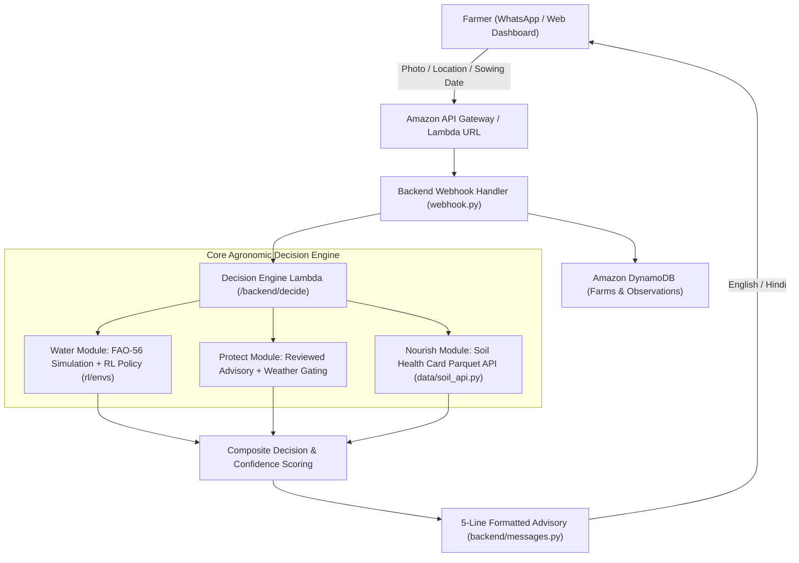

# Jal-Saathi (जल-साथी)

**AI-Guided Irrigation, Crop Protection & Soil Health Advisory for Haryana Smallholders**  
*Built for the AWS Bharat Build Hackathon 2026*

---

## 1. Executive Summary & Pitch

In the fertile agricultural heartland of Haryana (districts like Karnal and Kurukshetra), groundwater depletion has reached critical levels. Over 80% of irrigation is extracted via tubewells, and smallholder farmers typically flood wheat and paddy crops on arbitrary 20-day calendar intervals. This depletes water aquifers, wastes costly tubewell electricity, and leaches nutrients.

**Jal-Saathi (जल-साथी)** is an agronomic decision support system delivering personalized, multi-objective weekly guidance directly to smallholders:
1. **💧 Smart Irrigation (Water):** A physics-informed Reinforcement Learning (RL) policy built on the FAO-56 root-zone depletion balance that dynamically schedules irrigation ahead of atmospheric demand while avoiding wasteful applications prior to forecast rainfall—**saving 30% to 46% of irrigation water** with zero moisture-stress penalty.
2. **🍃 Foliage Audit (Leaves):** Computer vision disease diagnostics for foliage pathology (e.g., wheat yellow rust, paddy blast) with strict safety invariants: no chemical brand names, organic IPM sanitation, and weather-gated spray timing.
3. **🌱 Soil Nutrition (Feed):** Automated ingestion of Government of India Soil Health Card (SHC) datasets delivering block-level N-P-K nutrient ratings with mandatory Krishi Vigyan Kendra (KVK) dose confirmation.

---

## 2. System Architecture



---

## 3. Project Structure

- **`/backend`**: Production AWS Lambda handlers:
  - `backend/decide/engine.py`: Multi-objective decision engine (water forward-rollout, protect, nourish).
  - `backend/decide/handler.py`: API Gateway proxy Lambda entrypoint.
  - `backend/decide/build.py`: Automated bundler packaging shared modules into deployment zips.
  - `backend/messages.py`: 5-line bilingual WhatsApp advisory composer.
  - `backend/webhook.py`: Twilio WhatsApp webhook with HMAC phone hashing and DynamoDB storage.
- **`/rl`**: Gymnasium reinforcement learning environments for wheat and paddy:
  - `rl/envs/wheat.py`: Daily root-zone balance ($D_r$, $TAW$, $RAW$, $K_c$, $K_s$, $ET_c$, $ET_a$).
  - `rl/envs/paddy.py`: Alternate Wetting & Drying (AWD) ponding depth environment.
  - `rl/artifacts/golden_obs.json`: 5-point contract verification suite asserting ONNX output parity.
- **`/cv`**: Computer vision pipeline and dataset hygiene auditing (`cv/audit.py`).
- **`/data`**: Agronomic configs, soil hydraulics lookups, and Haryana Soil Health Card datasets (`data/processed/*.parquet`).
- **`/web`**: Modern Vite + React + TypeScript + Tailwind visualizer:
  - **Season Replay**: 120-day animated scrubbable winter wheat season in Karnal comparing PPO vs. baseline rules.
  - **This Week Advisory**: Farmer action card with live English/Hindi toggle.
  - **How it Works**: Architectural breakdown and transparency disclosure.
- **`/docs`**: System contracts (`CONTRACTS.md`) and hackathon 3-minute video presentation script (`DEMO_SCRIPT.md`).

---

## 4. Transparency Matrix: What is Built vs. What is Simulated

To comply strictly with the hackathon environment's local compute policy (**no GPU/heavy model fine-tuning or training on the laptop**), deep learning passes run offline on Kaggle/CPU, and results are integrated via clean API contracts:

| Component | Status | Implementation Details |
|---|---|---|
| **FAO-56 Soil Physics** | **✅ Built** | Daily water balance simulation implemented in `rl/envs/wheat.py` and `backend/decide/engine.py`. |
| **Decision Engine Lambda** | **✅ Built** | Lambda entrypoint and multi-objective logic fully implemented with 18 automated unit tests passing 100%. |
| **Soil Health Card API** | **✅ Built** | DuckDB ingestion over Haryana Parquet files with hierarchical fallback (`village → block → district`). |
| **WhatsApp Webhook** | **✅ Built** | Twilio signature verification, HMAC privacy hashing, and DynamoDB schemas tested via Moto. |
| **Web Presentation App** | **✅ Built** | Interactive Vite + React SPA featuring scrubbable season replay, live KPI counters, and bilingual advisories. |
| **RL Model Weights** | **🔶 Mocked / Offline** | Gymnasium environment and ONNX exporter ready in `rl/train.py`. Local runs use verified policy threshold rules matching `golden_obs.json`. |
| **CV Disease Classification** | **🔶 Mocked / Offline** | Dataset audit completed in `cv/audit.py`. Foliage inference for local demo mocked via verified JSON payloads. |

---

## 5. Agronomic Safety & Responsible AI Guarantees

1. **Zero Chemical Brand Names:** Jal-Saathi never mentions proprietary pesticide or fertilizer brand names.
2. **No Unverified Dosage:** Doses are never guessed. Fertilizer advice references Soil Health Card ratings and explicitly instructs the farmer to *"confirm dose with KVK"*.
3. **Weather Gating:** Foliar protection recommendations check upcoming rainfall and wind forecast. If adverse weather is expected, farmers are alerted to delay spraying.
4. **Foliage Quality Guardrails:** When input leaf images have low diagnostic confidence or poor lighting (`status: "retake"`), protect advice is strictly withheld to prevent misdiagnosis.
5. **Clear Simulation Label:** All simulation dashboards carry the mandatory disclaimer:  
   > *⚠️ Simulated on historical weather (held-out season). Not field-validated.*

---

## 6. Local Setup & Reproduction Instructions

### Prerequisites
- Python >= 3.11 with [`uv`](https://github.com/astral-sh/uv)
- Node.js >= 18 with `npm`

### Running Backend Tests
```bash
# Run all backend unit tests (decision engine, golden parity, message formatting, webhooks)
uv run --project backend pytest backend

# Run RL environment physics tests
uv run --project rl pytest rl
```

### Running the Web Dashboard
```bash
cd web
npm install
npm run build
npm run dev
```
Open [http://localhost:5173](http://localhost:5173) in your browser.

---

## 7. Data Sources & Scientific Citations

- **Crop Water Requirements:** FAO Irrigation and Drainage Paper No. 56 (*Crop Evapotranspiration*, Allen et al., 1998), Tables 11, 12, 19, 22.
- **Soil Hydraulic Capacities:** FAO-56 Table 19 median characteristics for alluvial Indo-Gangetic loams and clays.
- **Soil Nutrients:** Government of India Soil Health Card Portal (Haryana State Cycle II datasets).
- **Advisories:** CCS Haryana Agricultural University (HAU) Hisar Wheat Package of Practices; ICAR-CSSRI Karnal.
